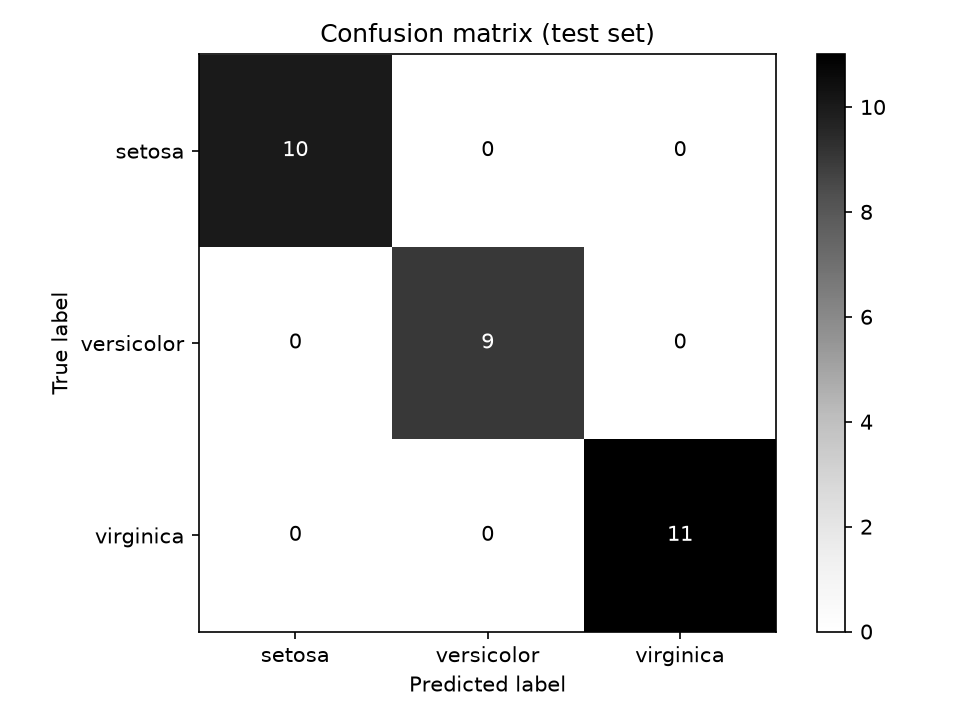

# Iris Classification

Classifies Iris flowers into three species (setosa, versicolor, virginica) from four measurements using logistic regression.

## How it works

1. **Load** the Iris dataset (150 flowers, 4 features: sepal length/width, petal length/width).
2. **Split** the data into 80% training and 20% test (`random_state=42` for reproducibility).
3. **Train** a logistic regression model on the training set.
4. **Evaluate** accuracy and a confusion matrix on the held-out test set.

## Results

| Metric   | Test set (30 samples) |
|----------|-----------------------|
| Accuracy | 1.00                  |



## Getting started

Prerequisites: Python 3.10+

```bash
git clone https://github.com/Ohm-Kel/iris-classification.git
cd iris-classification
python -m venv .venv
.venv\Scripts\Activate.ps1      # Windows
# source .venv/bin/activate     # macOS/Linux
pip install -r requirements.txt
pip install -e ".[dev]"
iris-train
```

## Running tests

```bash
pytest -v
```

The tests check data loading, the train/test split sizes, a minimum accuracy of 0.90, and that the confusion matrix image is created.

## Project structure

```
src/iris_classifier/model.py   # load, split, train, evaluate, plot
tests/test_model.py            # unit tests (pytest)
docs/confusion_matrix.png      # generated evaluation chart
pyproject.toml                 # package metadata, dependencies, pytest config
requirements.txt               # pinned versions for reproducibility
```

## Limitations

The Iris dataset is small and easy to separate, so perfect test accuracy is expected and doesn't reflect how the model would perform on harder real-world data.

## Tech stack

Python, scikit-learn, matplotlib, pytest

## License

MIT